<p align="center">
  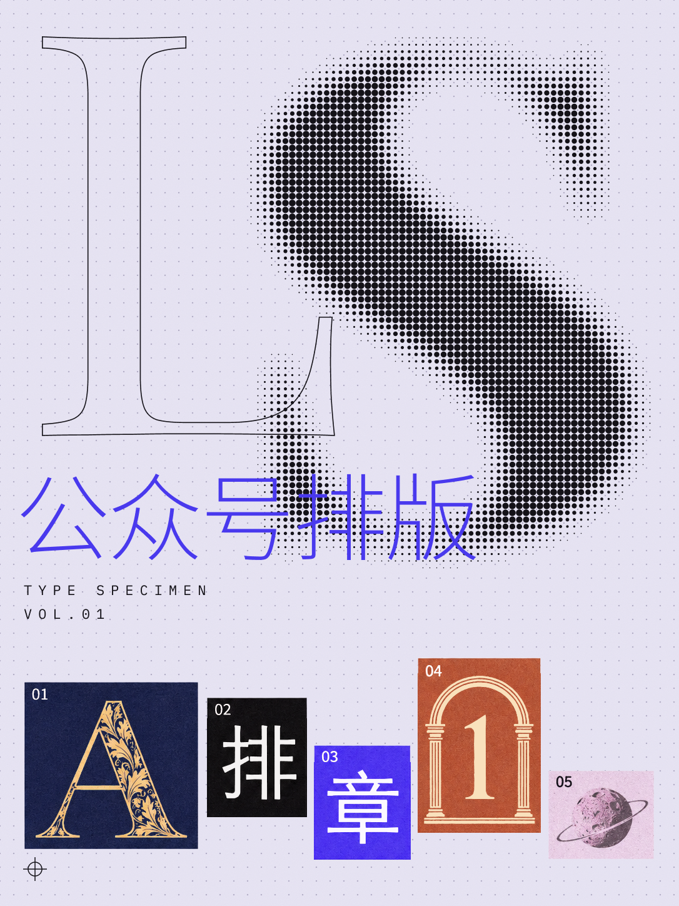
</p>

# LSF 公众号排版 Skill

把长文排成可编辑的微信公众号富文本。用 Dinamo 先选开篇动效、章节标记、文末贴纸和截图背景，再把选择带回 Codex 排版。

## 效果预览

左边选样式，右边实时查看文章效果。

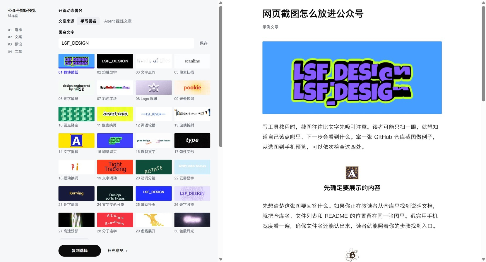

### 开篇署名

| 01 翻转贴纸 | 07 彩色字块 |
| :---: | :---: |
|  |  |

<details>
<summary>展开全部 29 款开篇动效</summary>

<table>
  <tr>
    <td align="center"><br />01 翻转贴纸</td>
    <td align="center"><br />02 熔融显字</td>
    <td align="center"><br />03 文字点阵</td>
    <td align="center"><br />05 像素扫描</td>
  </tr>
  <tr>
    <td align="center">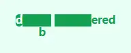<br />06 逐字解码</td>
    <td align="center"><br />07 彩色字块</td>
    <td align="center"><br />08 Logo 浮雕</td>
    <td align="center"><br />09 光晕换词</td>
  </tr>
  <tr>
    <td align="center"><br />10 圆点镂空</td>
    <td align="center"><br />11 像素换页</td>
    <td align="center">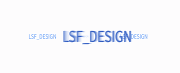<br />12 词语轮播</td>
    <td align="center">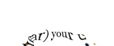<br />13 玻璃折射</td>
  </tr>
  <tr>
    <td align="center"><br />14 文字拆解</td>
    <td align="center"><br />15 印章切页</td>
    <td align="center"><br />16 爆裂文字</td>
    <td align="center"><br />17 弹性变形</td>
  </tr>
  <tr>
    <td align="center"><br />18 摆动换词</td>
    <td align="center"><br />19 文字涌动</td>
    <td align="center"><br />20 动词分镜</td>
    <td align="center"><br />22 云雾显字</td>
  </tr>
  <tr>
    <td align="center"><br />23 逐字翻牌</td>
    <td align="center"><br />24 文字变形分镜</td>
    <td align="center"><br />25 滚动换页</td>
    <td align="center">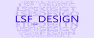<br />26 叠字收拢</td>
  </tr>
  <tr>
    <td align="center"><br />27 高速残影</td>
    <td align="center"><br />28 分子连字</td>
    <td align="center"><br />29 虚线展开</td>
    <td align="center"><br />30 色散辉光</td>
  </tr>
  <tr>
    <td align="center"><br />31 流墨显字</td>
  </tr>
</table>

</details>

### 章节标记与文末贴纸

| 动态字母 | 动态数字 | 星球变火箭 | AI 图标旋转环 |
| :---: | :---: | :---: | :---: |
|  |  |  | 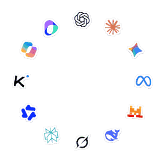 |

### 截图背景

同一张截图使用三种背景。

| 日落 · Moonvy | 星河 | 金雨 |
| :---: | :---: | :---: |
| 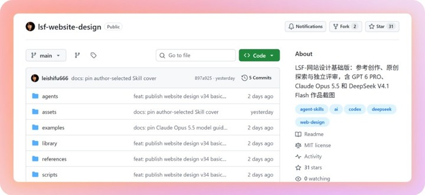 | 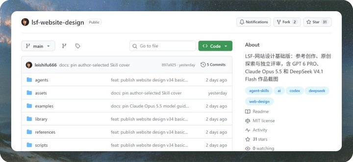 | 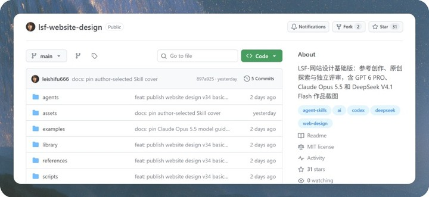 |

<details>
<summary>查看窄屏文章排版</summary>

<p align="center">
  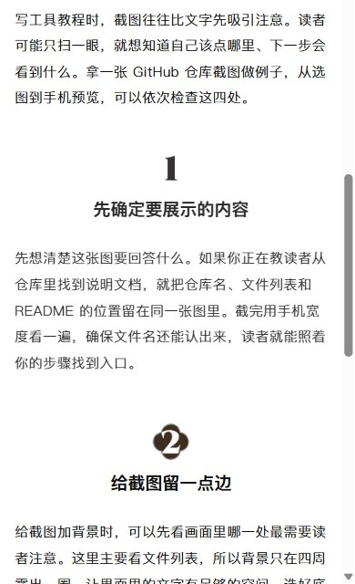
</p>

</details>

## 使用

在 Codex 的技能目录下放入本仓库，调用 `$lsf-wechat-editorial-layout` 并提供文章或草稿。仓库的 [SKILL.md](SKILL.md) 是任务入口。

也可以在仓库根目录用 Python 生成选样页：

```bash
python -X utf8 scripts/build-style-preview.py --author "你的署名" --output "preview.html"
```

用浏览器打开 `preview.html`。选样页包含 29 款开篇动效、动态字母与数字、三款文末贴纸和 28 款截图背景。可导出 640 × 260 的开篇 GIF 或 PNG，也可备份和导入命名预设。选题明确后先打开 HTML 选样页。已有文章时用 `--article` 带入标题、正文和本地配图，按正式模板的字号与留白预览。截图可换背景并逐张导出 PNG。

- [选样和生成参数](references/style-picker.md)
- [正文排版基线](references/article-layout.md)
- [截图和公众号草稿流程](references/wechat-draft.md)

## 许可

本项目原创代码和文档使用 [MIT](LICENSE)。第三方代码、字形和品牌素材按各自条款及归属管理，见 [第三方声明](THIRD_PARTY_NOTICES.md)。
